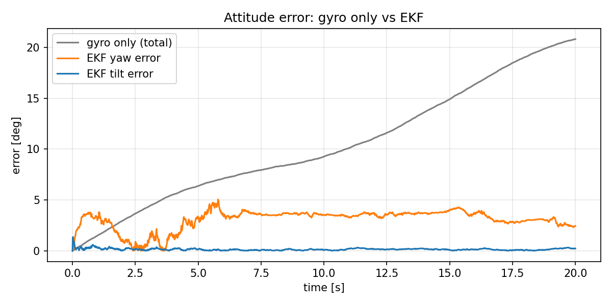
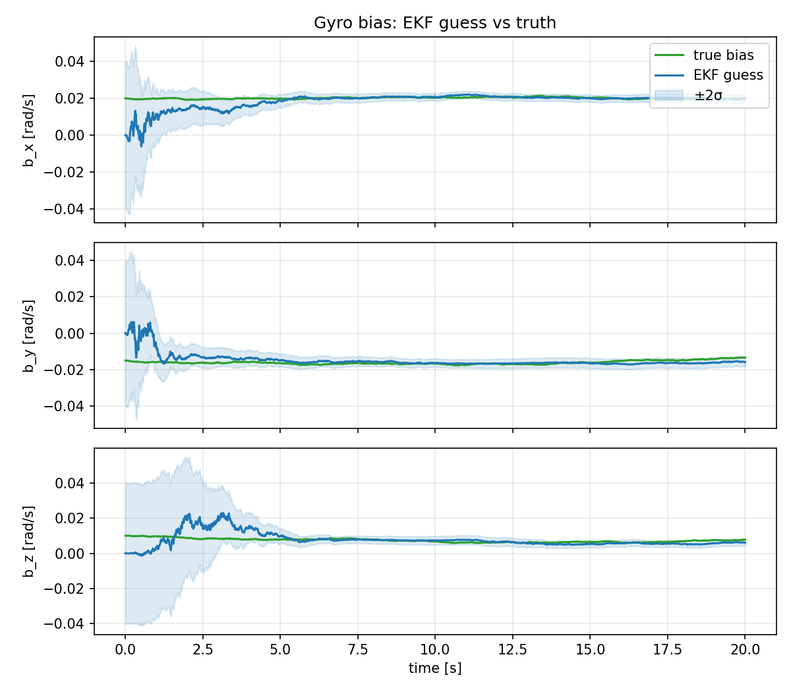
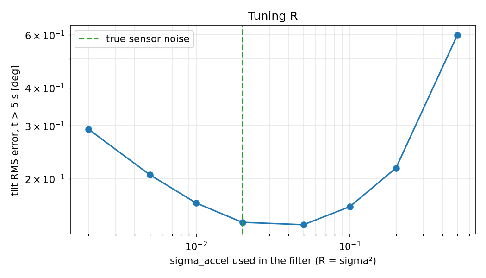

# ekf-robot — Quaternion MEKF for attitude and gyro-bias estimation

A 3D attitude estimator written from scratch in Python/NumPy.
It fuses a **gyroscope** and an **accelerometer** with a **multiplicative extended Kalman filter (MEKF)**
and estimates the **gyro bias** online.
Tested on simulated IMU data with known truth. Target platform: a ROS 2 robot (hardware integration planned for January 2027, see *Next steps*).



## Results (20 s simulated run, 100 Hz)

| Method | Final attitude error |
|---|---|
| Gyro integration only | **20.8°** (drift from the gyro bias) |
| MEKF — tilt (roll/pitch) | **0.14° RMS** |
| MEKF — yaw | ~3° (not observable with an accelerometer, see *Limits*) |

- The gyro bias guess converges to the true bias in about **5 s**, inside the filter's ±2σ band.
- The tilt error is lowest when the filter's accelerometer noise matches the real sensor noise (U-shaped tuning curve).

| Bias convergence | Tuning the measurement noise R |
|---|---|
|  |  |

## How it works

**State:** `x = [q (4), b (3)]` — attitude quaternion and gyro bias.
**Error state / covariance:** `P` is 6×6 over `[δθ (3), δb (3)]`.
The attitude error is a small rotation, so `P` has 3 attitude dimensions, not 4 (the unit-norm constraint removes one).

Each time step (dt = 0.01 s):

1. **Predict** — integrate `q̇ = ½ q ⊗ [0, ω̃ − b̂]` with RK4, then normalize. Bias unchanged.
2. **Propagate covariance** — `P ← Φ P Φᵀ + Q`, with
   `F = [[−[ω̂]×, −I], [0, 0]]`, `Φ ≈ I + F·dt`.
3. **Update** with the accelerometer (direction of gravity):
   - expected reading `â = R(q̂)ᵀ g`, innovation `y = ã − â`
   - `H = [[â]×, 0]`, `K = P Hᵀ (H P Hᵀ + R)⁻¹`
   - correction `[δθ, δb] = K y`; attitude corrected **multiplicatively**: `q̂ ← q̂ ⊗ [1, δθ/2]`, then `b̂ ← b̂ + δb`
   - `P ← (I − K H) P`

The bias is never measured directly. It is learned through the correlation between attitude error and bias error that builds up in `P` during prediction.

Convention: scalar-first Hamilton quaternions, `q = [w, x, y, z]`, body → world.

## Files

| File | Contents |
|---|---|
| `quaternion.py` | Quaternion math: product, conjugate, rotation, DCM, skew matrix, kinematics, RK4 |
| `simulate.py` | Fake world: true motion, noisy gyro (with random-walk bias) and accelerometer |
| `ekf.py` | The filter: `predict`, `propagate_P`, `update`, `run_filter`, error metrics |
| `test_quaternion.py` | 37 tests, from single quaternion operations up to the full filter run |
| `plot_results.py` | Runs the filter and saves the three figures in `results/` |

## Run it

```bash
pip install numpy matplotlib
python test_quaternion.py     # every line should end in True
python plot_results.py        # about 1 minute, writes results/*.png
```

## Limits

- **Yaw is not observable.** An accelerometer only senses the direction of gravity, so a rotation about the vertical axis changes nothing it can measure. Yaw error stops growing once the bias is learned, but early drift is never removed. A magnetometer would fix this.
- **Simulation only.** Sensor noise is white Gaussian plus a random-walk bias. A real IMU also has scale-factor errors, misalignment and temperature drift.
- **No linear acceleration.** The accelerometer model assumes the body does not accelerate, so it sees gravity only.
- First-order discretization `Φ ≈ I + F·dt` (fine at 100 Hz).

## Next steps

- [ ] Add a magnetometer to make yaw observable
- [ ] Run on real IMU data on a ROS 2 robot
- [ ] Close the loop: attitude control with reaction wheels using this estimate

## What I learned

*(To be written by me.)*
